# 本地知识工作台 0.3.1

Local Knowledge Workbench。一个放在你自己电脑上的知识工作台。

把已经在用的文件夹、阅读、工作区，以及准备给 AI 的资料，收进同一个应用。原文件留在原来的位置。不绑定任何一家 AI：复制链接即可接入、资料留在本地。要交给 AI 时，复制链接或带上剧本，贴到你正在用的工具里。

## 亮点

- **工作区总览**：按全部、最近、收藏查看工作区，单击卡片回到那份现场。
- **侧栏模式**：窗口可以收成侧栏；卡片用鼠标左键、右键、中键放进最多三栏。
- **明暗和配色**：浅色、深色或跟随系统。主色可以换成墨绿、暖橙、玫瑰或石墨，也可以改回默认蓝。
- **卡片和分类**：侧栏卡片有小、中、大、特大四档。最近和收藏是默认分类，不能改名，也不能删除。
- **多种格式**：PDF 按页阅读；docx、xlsx、pptx、epub、odt、rtf、ofd 等在应用里打开。不含 OCR。
- **资料留在本地**：不绑定任何一家 AI，复制链接即可接入、资料留在本地。Agent 资料按引用加入；重生仓库保存总结和备份；上下文剧本附带六份模板。

顶栏的圆角 K 是品牌标，颜色跟主色走，默认是蓝。

## 工作区总览

一份工作区记住你打开的文件、分栏和阅读位置。顶栏「工作区总览」列出这些工作区。

左侧是分类。全部、最近、收藏始终在。最近和收藏不能改名，也不能删除。需要别的分组时，用「新建分类」。右侧是工作区卡片，单击进入。布局预设用来改分栏，例如单栏、左右两栏、上下两栏；当前主题还可以提供三栏、专注阅读等预设。

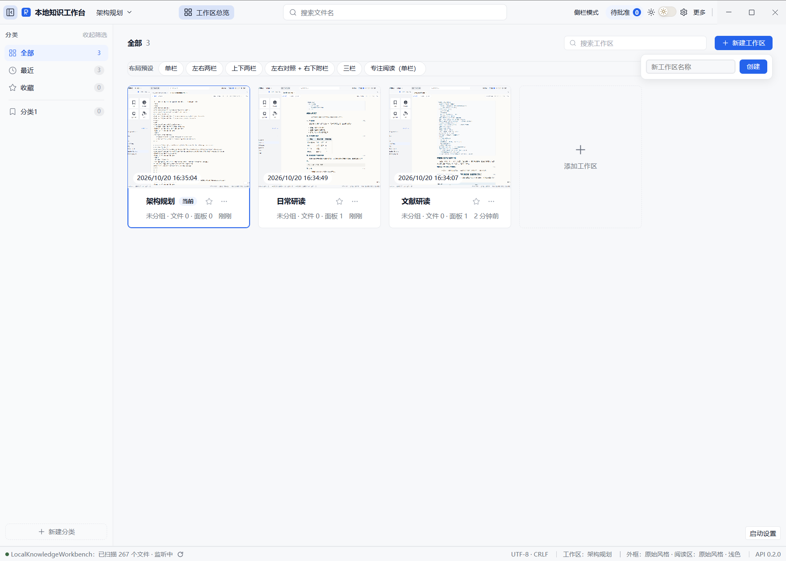

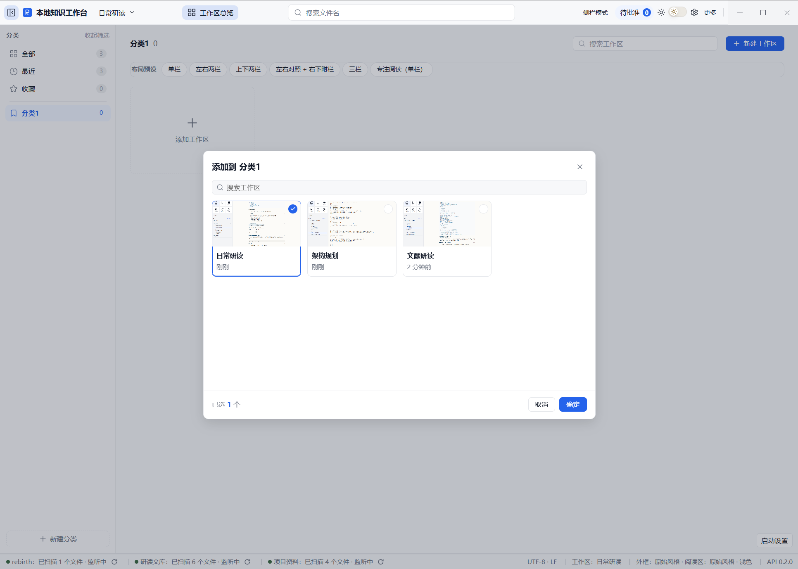

## 侧栏模式和多栏

顶栏「侧栏模式」把窗口收成一条侧栏，快捷键是 Ctrl+Alt+S。

侧栏里的卡片包括根目录、收藏、网络资料、工作台资料、Agent 资料和插件。把鼠标放在卡片上：

- 左键放进第 1 栏
- 右键放进第 2 栏
- 中键放进第 3 栏

再点一次同一张卡片，把它从那一栏拿掉。最多三栏。

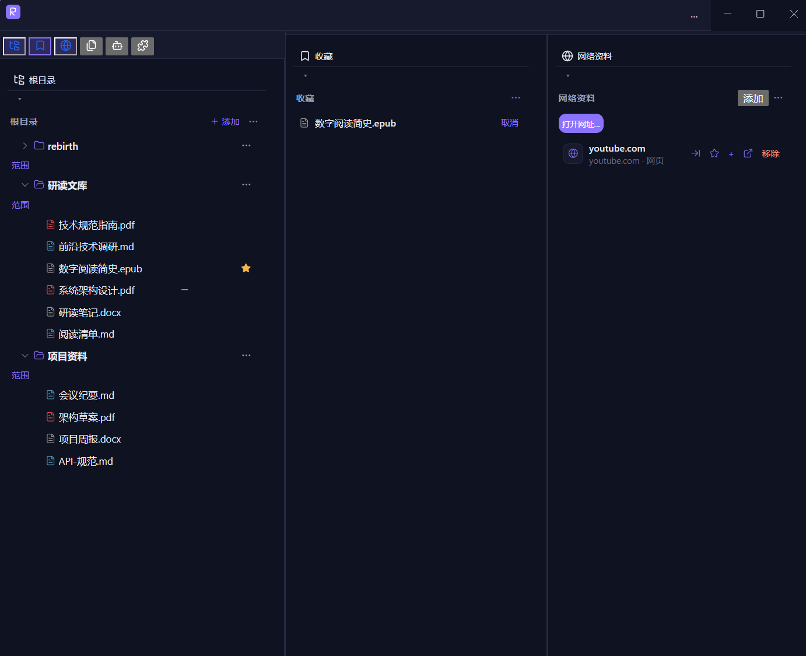

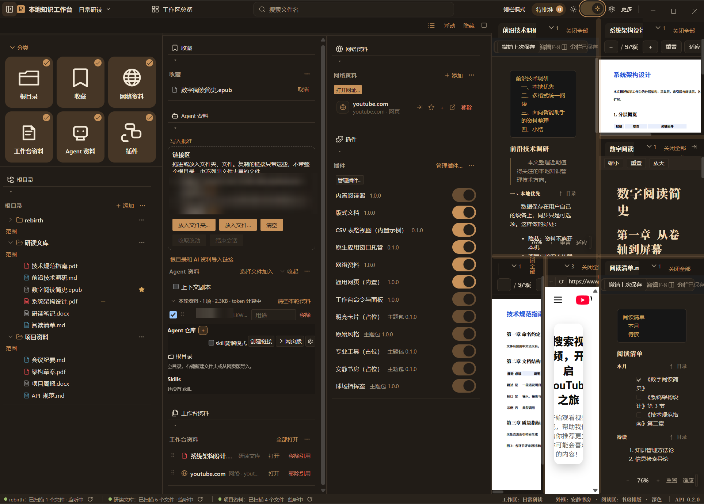

卡片大小在「外观」里改，也可以在卡片之间的空白处右键。点在卡片上的右键是放进第 2 栏，不是改尺寸。

## 外观

明暗有三档：浅色、深色、跟随系统。在外观页选，顶栏也可以切换。

自定义颜色在外观的「高级选项」里，盖在当前的浅色或深色上面。可以改主色、背景、侧栏、卡片、文字、边框和几种状态色。五档预设只改主色和选中底：默认蓝、墨绿、暖橙、玫瑰、石墨。「重置」回到当前主题自己的颜色。

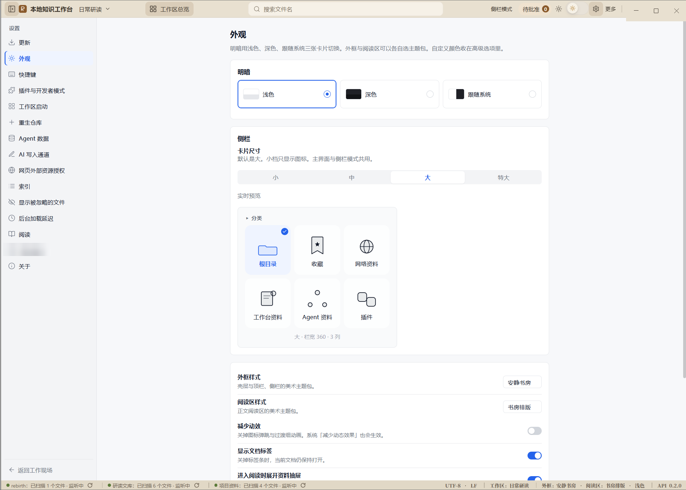

## 卡片尺寸

四档是小、中、大、特大，默认是大。小档只显示图标，不显示卡片名字。主界面和侧栏模式用同一档。

## 阅读

在根目录里添加已经有的文件夹，再点文件打开。PDF 按页显示，可以缩放。下面这些格式也在应用内打开：

| 种类 | 扩展名 |
| --- | --- |
| 文档 | docx、odt、rtf、wps |
| 表格 | xlsx、et |
| 幻灯片 | pptx、dps |
| 电子书 | epub |
| 版式 | ofd、pdf |

不含文字识别。扫描版 PDF 不会因此变成可选中的文字。顶栏搜索目前搜的是文件名，不是正文。

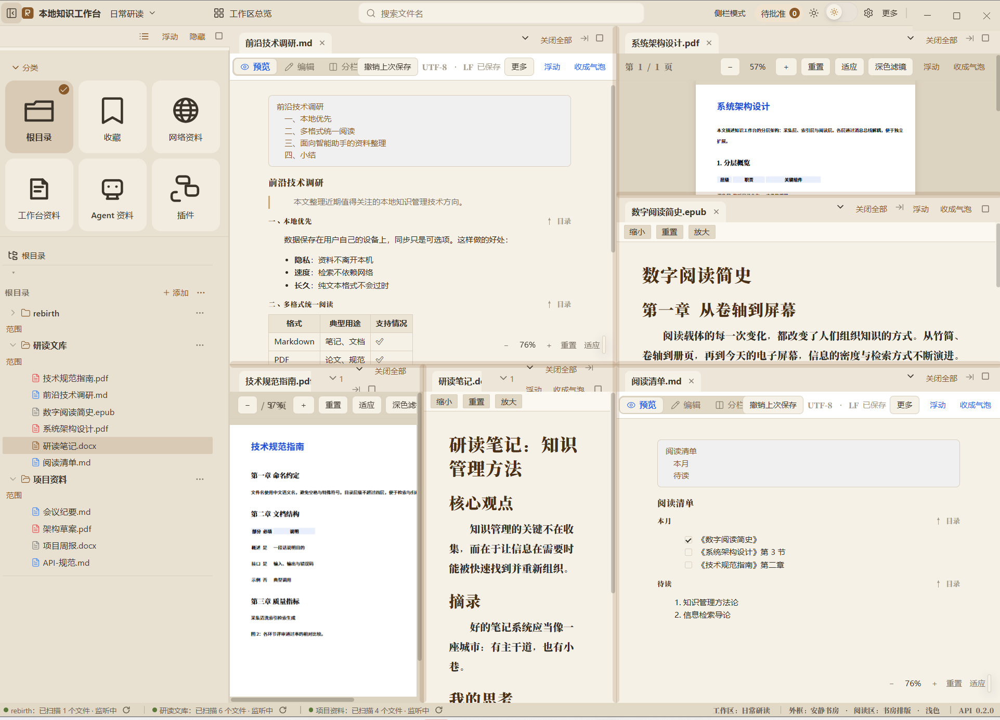

## 给 AI 准备资料

不绑定任何一家 AI：复制链接即可接入、资料留在本地。工作台不提供某一家的登录，也不替你调用模型。文件和索引都在本机。你复制出去的是链接或一段按剧本组织的上下文。

### Agent 资料

侧栏的「Agent 资料」查看当前要交给 AI 的文件。从「全局 Agent 库」加入时按引用：确认之后文件仍在全局库，工作区里用的是引用。技能库用来放可反复使用的 SKILL；库是空的时，界面会直接写还没有 skill。

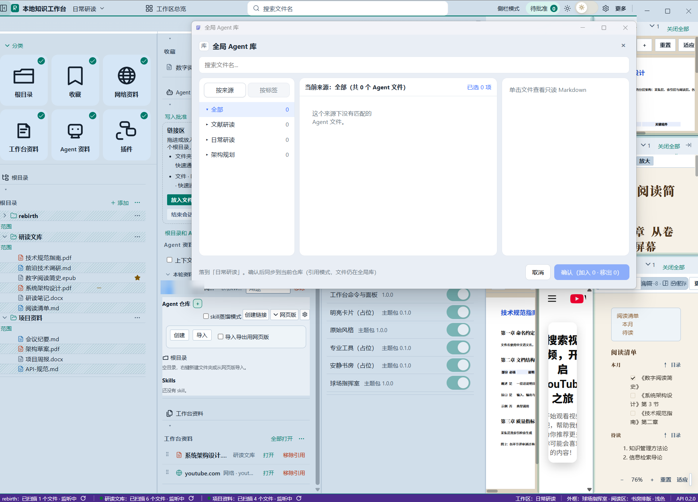

### 重生仓库

重生仓库用来放整理后的总结。总结格式可以换预设，也可以自己加块。仓库地址可以改到别的文件夹；更改时把文件和清单整套复制过去，旧地址保留，不删除。

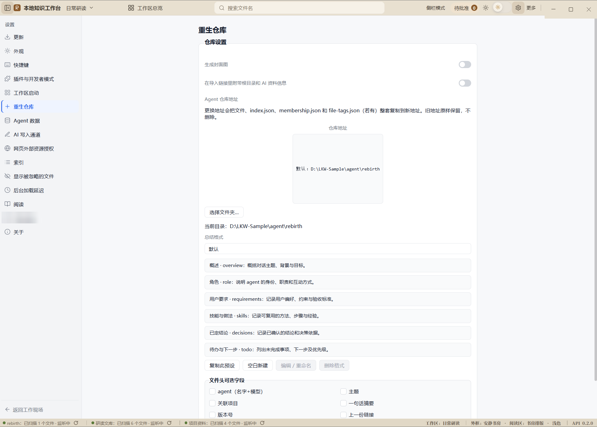

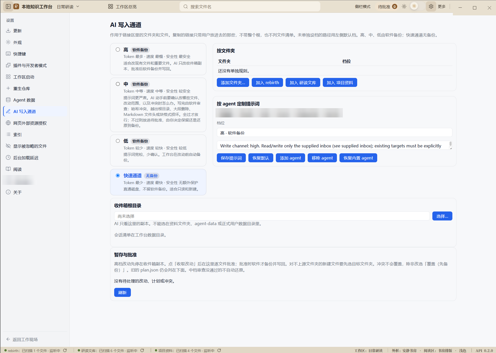

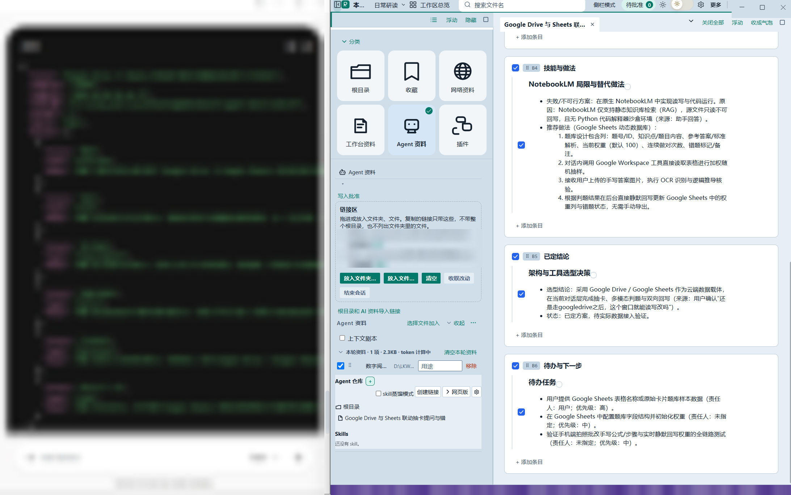

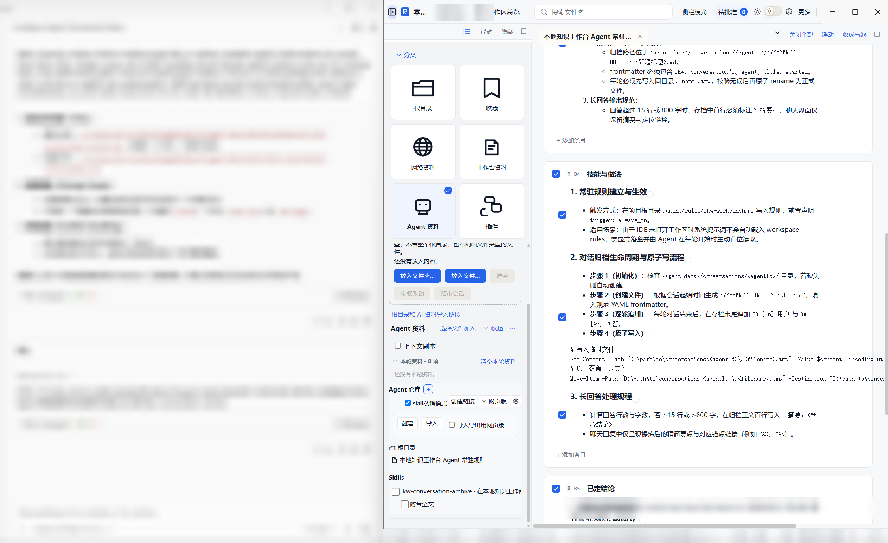

在一份重生资料的编辑器里，「版本」菜单默认收着。展开后可以选择恢复某一次备份。这是这份重生资料的备份，不是所有各类文档的历史。还没有备份时，菜单会写还没有备份版本。

### 上下文剧本

剧本栏可以关掉。关掉时，复制出去的内容不带剧本。打开后选择模板，写一行任务，并看当前大概用了多少预算。内置六份：改代码、数据处理、答疑研究、复用 skill、规格驱动、写文档。没有放进槽里的资料不会进粘贴。

## 安装和上手

### 在 Windows 上使用

0.3.1 的安装包文件名是 `LocalKnowledgeWorkbench-0.3.1-win-x64-setup.exe`，另有同版的 portable 单文件。安装到当前用户，不需要管理员，可以选择目录。桌面和开始菜单的快捷方式名叫「本地知识工作台」。

卸载时会问要不要删除用户数据，默认保留。已注册文件夹里的文件不会被卸载程序删除。

下载地址：[v0.3.1 发布页](https://github.com/hyx226373/LocalKnowledgeWorkbench/releases/tag/v0.3.1)。

安装包里附带 Obsidian 插件 lkw-bridge 0.2.2，默认不启用；需要时在「设置 → Obsidian → 初始化中转库」里打开。

上手：

1. 打开应用。
2. 在侧栏「根目录」点「添加」，选一个已经在用的文件夹。
3. 点开其中的文件阅读。
4. 需要切换现场时打开「工作区总览」；需要窄边停靠时打开「侧栏模式」。

### 源码构建与开发

需要 Node.js 20 或更高版本。Windows 安装包的打包步骤、数据目录和签名说明见 `workbench/docs/07-打包与发布.md`。完整的环境配置、常用开发命令与架构说明见文末保留的原开发说明。

## 资料留在本地

添加根目录只是登记，不把文件拷进应用，也不改文件名。

索引、工作区布局和相关元数据在本机应用数据目录：

- Windows：`%LOCALAPPDATA%\LocalKnowledgeWorkbench`
- Linux：`~/.config/LocalKnowledgeWorkbench`

从更早版本升级时，如果旧数据还在 `%APPDATA%\LocalKnowledgeWorkbench`，而新目录还没有库，第一次启动会把旧目录搬过来。

可以用环境变量 `KB_USER_DATA` 指定数据目录（便携或测试时用）。

## 常见问题

**文件会被应用拷走吗？**  
注册根不会。Agent 资料从全局库加入时是引用，文件仍在全局库。更改重生仓库地址时，会往新地址复制一套，旧地址还在。

**必须使用某一家 AI 吗？**  
不需要。复制链接即可接入、资料留在本地。工作台不绑定任何一家 AI，没有账号登录或模型绑定限制。把自己的工具打开，把复制出去的链接或剧本贴进去即可。

**能搜索正文吗？**  
顶栏搜索的是文件名。正文索引的总开关在这个版本是关的。

**「版本」菜单能恢复任意文件吗？**  
不能。它在重生资料编辑器里，恢复的是这份资料的备份。

**深色和自定义颜色哪个优先？**  
先有浅色或深色，自定义颜色再盖上去。重置之后回到当前主题的颜色。品牌 K 用的是主色，所以换主色时 K 会跟着变，默认才是蓝。

**小卡片为什么没有字？**  
小档只显示图标。中、大、特大才显示卡片名。

## 更多文档

产品约束、打包、适配器和数据迁移的原文在 `workbench/docs/`：

- `workbench/docs/01-产品规格.md`
- `workbench/docs/02-技术方案.md`
- `workbench/docs/06-适配器宿主.md`
- `workbench/docs/07-打包与发布.md`
- `docs/10-日常工作流（资料·编辑·分级加载）.md`
- `docs/12-数据迁移.md`

`workbench/docs/01` 写于更早的版本。和 0.3.1 不一致的地方，以本介绍和当前源码为准，例如数据目录在 LocalAppData，顶栏搜索不是正文搜索。

---

以下保留原 README 开发说明

## 源码结构

- `workbench/`：Electron、TypeScript、React 主应用。
- `modules/`：文件操作、资料身份、计划、同步、索引与 agent 接口模块。
- `modules-r11-E-3888323/indexer/`：主应用引用的正文索引分支。
- `kb-adapter-sdk/`：插件适配器 SDK。
- `SOURCE-PROVENANCE.json`：导出的原始提交和交付边界。

主应用来自 0.3.1 提交 `ff94831`。本仓以独立源码快照提交，未复制正在修改的工作树、用户数据库、登录凭据、安装目录或私人资料。外部模块按记录的提交导出；本次未进行重新构建，源码到安装包的完整复现尚未验证。

## 开发

各模块的安装、构建入口见相应 `package.json`；模块完成构建后，在 `workbench/` 中安装依赖并运行 `npm run dev` 或 `npm run build`。详细架构与接口资料见 `workbench/docs/`。应用内部的历史 README 和 MODULES-PIN.md 属于原始快照，当前导出来源以根目录 SOURCE-PROVENANCE.json 为准。

目前通过手动下载和覆盖更新程序，用户数据单独保存在 `%LOCALAPPDATA%\LocalKnowledgeWorkbench`。
