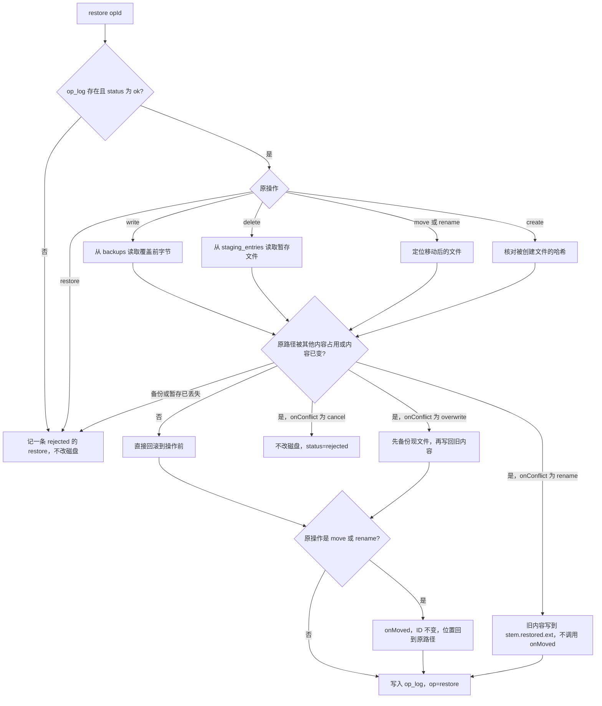

# @kb/fileops

## 稳定接口 v1.1

本包只导出下面这些类型和 `createFileOps`。建表只通过 `createFileOps(deps).migrate()`，`db` 来自 `deps`，没有第二套入口。

```ts
import type { Database } from "better-sqlite3";

export type Actor = "ui" | `agent:${string}`;

export interface ResolvedInside {
  rootId: string;
  relPath: string;
  absPath: string;
  resourceId: string | null;
}

export type ResolveInsideRoot = (
  db: Database,
  rootId: string,
  relPath: string
) => ResolvedInside | Promise<ResolvedInside>;

export type EnsureResource = (
  db: Database,
  rootId: string,
  relPath: string
) => string | Promise<string>;

export interface LocationRef {
  rootId: string;
  relPath: string;
}

export type OnMoved = (
  resourceId: string,
  before: LocationRef,
  after: LocationRef
) => void | Promise<void>;

export type FileOp =
  | { type: "create"; rootId: string; relPath: string; content: string | Uint8Array }
  | { type: "write"; rootId: string; relPath: string; content: string | Uint8Array }
  | { type: "move"; rootId: string; fromRelPath: string; toRelPath: string; toRootId?: string }
  | { type: "rename"; rootId: string; fromRelPath: string; toRelPath: string }
  | { type: "delete"; rootId: string; relPath: string };

export interface Conflict {
  code: "exists" | "missing" | "outside-root" | "conflict";
  relPath: string;
  message: string;
}

export interface PreviewResult {
  summary: string;
  affected: string[];
  conflicts: Conflict[];
}

export type OnConflict = "cancel" | "rename" | "overwrite";

export interface ApplyResult {
  opId: string;
  status: "ok" | "rejected";
}

export interface FileOpsDeps {
  db: Database;
  dataDir: string;
  resolveInsideRoot: ResolveInsideRoot;
  ensureResource: EnsureResource;
  onMoved: OnMoved;
  retentionMs?: number;
}

export interface FileOps {
  migrate(): void;
  preview(op: FileOp): Promise<PreviewResult>;
  apply(op: FileOp, opts: { actor: Actor; overwrite?: boolean }): Promise<ApplyResult>;
  previewRestore(opId: string): Promise<PreviewResult>;
  restore(opId: string, opts: { actor: Actor; onConflict: OnConflict }): Promise<ApplyResult>;
  listExpired(now?: number): Promise<Array<{ id: string; relPath: string; storedPath: string; expiresAt: number }>>;
  purgeExpired(now?: number): Promise<void>;
  recoverIncomplete(): Promise<Array<{ opId: string; status: string; error: string | null }>>;
}

export function createFileOps(deps: FileOpsDeps): FileOps;
```

<!-- INTERFACE_READY -->
<!-- INTERFACE_V1_1 -->

## 稳定接口 v1.2

这一节补充 v1.1。没写到的行为仍按 v1.1。

`move` 增加可选字段 `toRootId?: string`，不改已有字段名。`rename` 没有这个字段，仍然只在同一个根里。

- 不传 `toRootId`，或它与 `rootId` 相同：移动和以前完全一样，源和目标都在 `rootId` 上。
- 传入另一个根：用 `resolveInsideRoot` 分别解析源根和目标根，再搬文件。`fs.renameSync` 遇到 `EXDEV` 时先复制到目标侧临时文件，再改名到位，然后删除源文件；复制或改名失败会删掉临时文件，不留下半份。
- 成功后 `onMoved(resourceId, { rootId: 源, relPath: 源 }, { rootId: 目标, relPath: 目标 })`。资料 ID 用源文件解析到的那个，不变。
- `before_json` / `after_json` 两边都写 `rootId` 和 `relPath`。`op_log.root_id` 仍记源根。
- 撤销这次 move 时把文件搬回去，并再次 `onMoved`，ID 不变。

拒绝（`status = rejected`）时，如果目标路径已经由 `resolveInsideRoot` 解析出非空 `resourceId`，写入 `op_log.resource_id`。

- `create` / `write` / `delete` 的目标是 `relPath`。
- `move` / `rename` 的目标是 `toRelPath`（跨根时是目标根上的那条）。源路径的 ID 不写入这次拒绝记录，除非目标路径解析到的就是它。
- 路径越界、词法非法、actor 非法、目标上没有活资料：`resource_id` 仍是 NULL。

## 行为

`createFileOps(deps).migrate()` 是唯一建表入口。调用 `preview`、`apply`、`restore` 之前必须先 `migrate()`。

### 路径

相对路径使用 `/`，写入记录前做 NFC。本包只做词法拒绝：

- 空路径、空路径段、`.` 会被折掉后若为空也拒绝
- NUL、反斜杠、冒号（盘符或 NTFS 流）
- 以 `/` 开头的绝对路径
- `..`
- Windows 设备名（`CON`、`NUL`、`COM1` 以及它们带扩展名的形式）

每次访问资料根里的路径之前，调用 `resolveInsideRoot(db, rootId, relPath)`。符号链接和 junction 的真实路径校验由这个回调负责，本包不复制一套 `realpath`。词法不通过时不会调用它。它抛错，或返回的 `absPath` 不是绝对路径，一律记为冲突 `outside-root`，不写盘。磁盘访问只用返回的 `absPath`。

`op_log.resource_id` 写入 `ResolvedInside.resourceId`。已有文件解析到 ID 时不再写 NULL。拒绝时是否写入，以「稳定接口 v1.2」为准（目标路径解析出非空 ID 才写，否则仍是 NULL）。`create` 把新文件写到磁盘之后调用 `ensureResource(db, rootId, relPath)`，把返回的 ID 回填到这条 op 的 `resource_id`。`move` 和 `rename` 成功后调用 `onMoved(resourceId, before, after)`。`before` 和 `after` 都是 `{ rootId, relPath }`，ID 用移动前解析到的那个。本包不 `UPDATE resources`。撤销 `move` / `rename` 并把文件移回时，同样调用 `onMoved`，ID 不变。解析结果没有 ID 时不调用 `onMoved`。跨根移动以 v1.2 为准。

`restore` 的 `onConflict` 来自调用参数。有冲突时按这次传入的 `cancel`、`rename` 或 `overwrite` 处理，库内不会改成固定的 `cancel`。

Windows 上同一文件只是大小写不同时，按改名处理，不当成“目标已存在”。

### 表

| 表 | 说明 |
| --- | --- |
| `op_log` | 约定列名不变。额外列：`phase`、`root_id`、`temp_path` |
| `backups` | 约定列名不变。`hash` 为文件内容 sha256 十六进制 |
| `staging_entries` | 本包的删除暂存记录，不要当成 `roots` / `resources` / `fts_content` / `root_mounts` |

`staging_entries` 列：`id`、`op_id`、`root_id`、`rel_path`、`stored_path`、`size`、`content_hash`、`created_at`、`expires_at`、`restored_at`、`purged_at`。

`backup_ref` 存 sha256，对应 `backups.hash`，没有备份时为 `NULL`。

备份文件在 `dataDir/backups/<hash>`，同一哈希只留一份，不写进资料根。删除是把文件移到 `dataDir/staging/<id>/<原文件名>`，不调用系统回收站，也不移到 `$Recycle.Bin`。保留 `retentionMs` 毫秒，默认 30 天。`listExpired(now)` 只列出到期且尚未恢复、尚未清理的记录；`purgeExpired` 只删除位于 `dataDir/staging` 内的路径。

### 操作

- `create`：目标必须不存在。`overwrite: true` 也不能覆盖已有文件。写完后 `ensureResource` 回填 `resource_id`。
- `write`：目标必须是已存在的普通文件。总是先备份再覆盖，不看 `overwrite`。`resource_id` 用写入前解析到的 ID。
- `move` / `rename`：在 `before_json.relPath` 和 `after_json.relPath` 记录前后位置，同时带上 `fromRelPath`、`toRelPath`，两边的 `rootId` 见 v1.2。目标已存在时 preview 的 `conflicts` 含 `exists`；`apply` 默认拒绝，源和目标字节都不变；只有 `overwrite: true` 才先备份目标再替换。成功后调用 `onMoved`，不在本包更新 `resources`。`rename` 只在同一个根里。跨根只适用于 `move` 的可选 `toRootId`，以 v1.2 为准；不传或与 `rootId` 相同时，行为与同根移动一致。
- `delete`：只处理普通文件。目录拒绝。

`preview` 不写盘、不写 `op_log`。`apply` 会再检查一遍，不沿用上一次 preview 的结论。拒绝的行 `status` 为 `rejected`，不会是 `ok`。`actor` 运行时必须是 `ui` 或 `agent:<name>`（名字非空）。

字符串内容按 UTF-8 写入，`Uint8Array` 按原始字节写入。同一卷上先把内容写入同目录临时文件并 `fsync`，再改名到目标。新建文件优先用硬链接占位，避免改名覆盖已经出现的目标。

`status`：`pending` 进行中，`ok` 已完成，`rejected` 已拒绝，`incomplete` 由 `recoverIncomplete()` 认定没做完。`phase` 供恢复判断，取值包括 `started`、`backed_up`、`temp_written`、`moved`、`committed`、`recovered`。

### 崩溃钩子

仅当环境变量 `KB_FILEOPS_CRASH_POINT=after-backup` 时，在备份已经写入 `backups` 且 `op_log.backup_ref` 已提交之后、替换目标文件之前，关闭数据库并 `process.exit(91)`。正常调用不要设置这个变量。

`recoverIncomplete()` 只处理 `status=pending` 的行：

- 删除属于该操作的 `*.kb-tmp`，不删除已经落盘的目标文件
- 若临时文件已经改名到位，且目标内容哈希与 `after_json.hash` 一致，补记 `ok`
- 移动或删除若磁盘结果已经完成，也补记 `ok`
- 否则把行标成 `incomplete`，并返回 `{ opId, status, error }`
- 再次调用不会重复返回已经处理过的行，也不自动重做写入

### 恢复

`previewRestore(opId)` 不改磁盘。只能恢复 `status=ok` 且 `op` 为 `create`、`write`、`move`、`rename`、`delete` 的记录。`restore` 本身不能再恢复。恢复成功时新写一条 `op_log`，`op` 为 `restore`，`actor` 用调用方传入的值。

无冲突时直接回滚，`onConflict` 不拦截这次回滚：

- 撤销 `write`：把 `backup_ref` 指向的覆盖前字节写回去
- 撤销 `delete`：把暂存文件放回原路径
- 撤销 `move` / `rename`：把文件从新路径移回旧路径，并调用 `onMoved`（ID 用原操作记下的那个）
- 撤销 `create`：把该文件移入应用暂存区

有冲突且备份或暂存内容还在时，`onConflict` 才生效：

- `cancel`：不改磁盘。这条 `restore` 记 `status=rejected`，`error` 为 `cancel`
- `rename`：旧内容写到不冲突的新名字 `<stem>.restored<ext>`，占用则用 `<stem>.restored-2<ext>` 继续编号。现文件不动。撤销 `create` 不能用 `rename`
- `overwrite`：先把现文件按 sha256 备份，再把旧内容写回原路径。不覆盖目录

内容与操作完成时不一致时，冲突 `message` 为 `当前内容与操作完成时不一致`。备份或暂存文件已经丢了，三种策略都拒绝，磁盘不变。

### before_json / after_json

`create`：`before` 为 `{ relPath, existed: false }`，`after` 为 `{ relPath, existed: true, size, hash }`。

`write`：两边都有 `{ relPath, existed: true, size, hash }`。`before.hash` 是覆盖前，`after.hash` 是写入后。

`move` / `rename`：两边都有 `{ rootId, relPath, fromRelPath, toRelPath, size, hash }`。`before.relPath` 是旧位置，`after.relPath` 是新位置。同根时两边 `rootId` 相同；跨根时 `before.rootId` 是源根，`after.rootId` 是目标根。`op_log.root_id` 仍是源根。

`delete`：`before` 为 `{ relPath, size, hash }`，`after` 为 `{ relPath, staged: true, stagingId, storedPath, hash, size }`。

`restore`：`before` 含 `restoresOpId` 和 `onConflict`，`after` 含恢复后的 `relPath`、`hash` 和 `applied`。

## 恢复流程



## 开发

不依赖 Electron。数据库实例由调用方传入，测试用 `better-sqlite3`。

```powershell
npm install
npm run build
npx vitest run
```

`npm run build` 用 tsc 把 `src` 编到 `dist/`，并生成 `.d.ts`。`main`、`types`、`exports` 指向 `dist`。源码里的 `.js` 说明符对应 dist 里的 `.js`，调用方不用注册导入改写。
