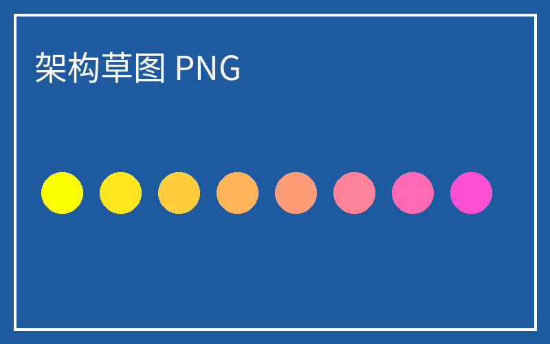

# 基准阅读页：本地知识工作台

> 这是主题截图使用的**固定**样例文档。不要修改它，否则不同主题之间的截图无法对比。

## 正文与列表

原始文件保持原位，索引与元数据单独保存。工作区记录标签、分栏、尺寸与阅读进度；主题只改变外观。

1. 外框样式：顶栏、侧栏、标签、分隔条、状态栏、对话框。
2. 阅读区样式：正文字体、行高、标题、链接、代码、表格、引用、PDF 背景。
3. 布局预设：只决定分栏排列，不属于主题。

- 无序列表项 A，带 [一个链接](https://example.com/)
- 无序列表项 B，带 `行内代码`
- 无序列表项 C，带 ==高亮== 与 **加粗** 与 *斜体*

## 表格

| 格式 | 阅读器 | 状态 |
| --- | --- | --- |
| Markdown | 内置 | ✅ |
| PDF | 内置（pdf.js） | ✅ |
| CSV | 插件 demo.csv-table | ✅ |

## 代码

```ts
// 主题只能使用令牌与受限 CSS
const theme = { chrome: 'study', reading: 'bright', scheme: 'dark' };
```

---

相对路径图片：



### 三级标题

最后一段，用于检查段落间距与行高。中文与 English 混排时的基线与字距。
